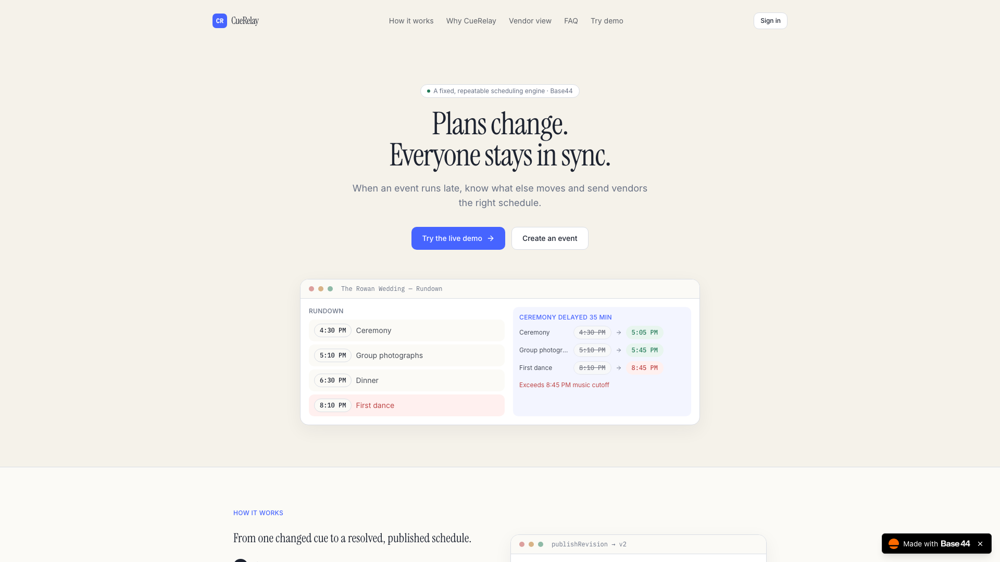
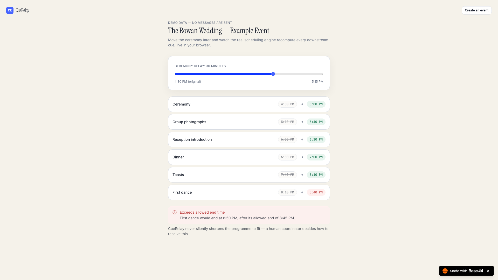
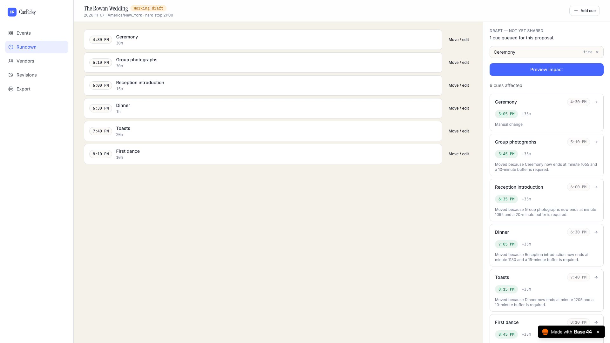
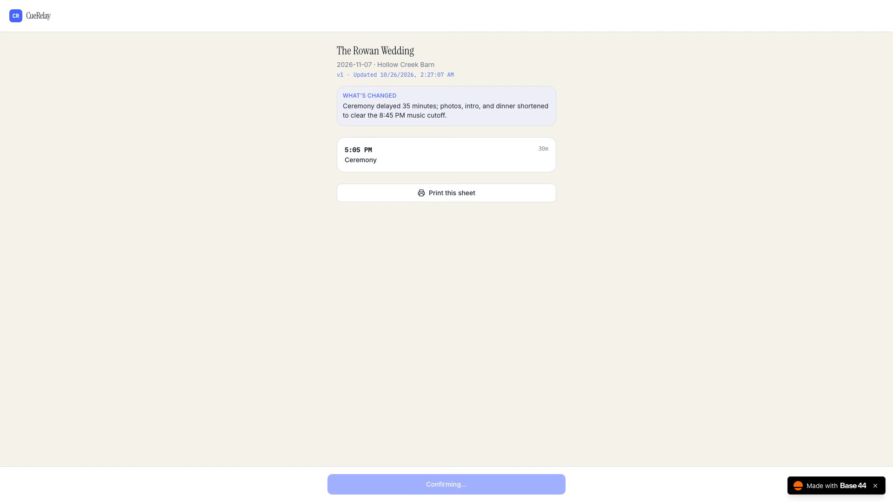
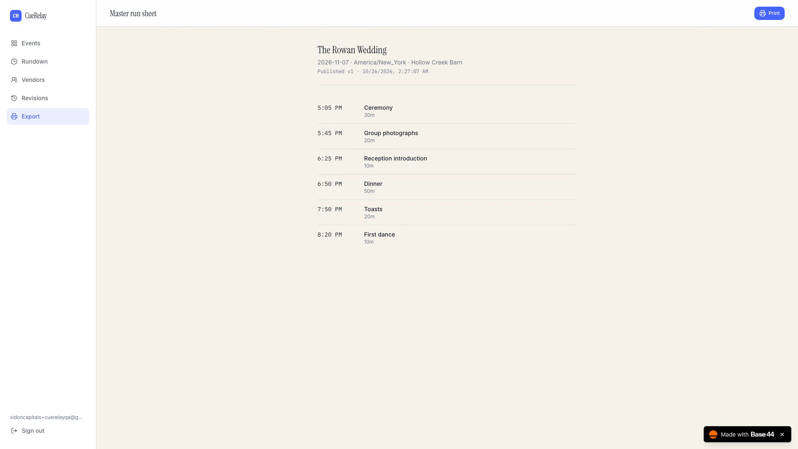

<div align="center">

# CueRelay

**Plans change. Everyone stays in sync.**

[](LICENSE)
[](https://base44.com)
[](https://cuerelay-41bbade8.base44.app)

[Live app](https://cuerelay-41bbade8.base44.app) · [Live demo (no sign-in)](https://cuerelay-41bbade8.base44.app/demo)

</div>

---

## The problem

A wedding or event coordinator runs a timeline of cues — ceremony, photos, dinner, toasts,
first dance — each depending on the one before it, some pinned to a fixed venue cutoff.
When one thing runs late, everything downstream has to be recalculated by hand, and every
vendor who's affected has to be told separately, hoping they see the message in time.

That recalculation is mechanical, but doing it under pressure, correctly, while also
deciding who actually needs to know, is where coordinators lose time and make mistakes.

## What CueRelay does

Change one cue's time. See exactly what else has to move, and whether anything breaks a
hard constraint, before anything is shared. Approve the resolution. Publish. Only the
vendors actually affected are notified, and you can see who has and hasn't confirmed they
have the new schedule.

```
Change a cue → preview the ripple → resolve conflicts → publish →
notify only affected vendors → track acknowledgement
```

Try it without signing in: **[cuerelay-41bbade8.base44.app/demo](https://cuerelay-41bbade8.base44.app/demo)**
— it runs the real scheduling engine in your browser against a fictional wedding, and
writes nothing.

## Why this isn't a toy problem

The scheduling engine is a dependency graph with real constraints, not a to-do list:

- **Two dependency types** — `FINISH_TO_START` and `START_TO_START`, each with a
  non-negative offset.
- **Fixed vs. flexible cues** — a fixed cue (say, a venue's hard close time) never moves
  automatically; if a dependency would force it to, that's a conflict, not a silent
  override.
- **A flexible cue never moves earlier on its own** — only later, and only because a
  real upstream dependency forced it. Manually shortening a cue is a deliberate,
  attributed decision, never something the engine does by itself.
- **Exclusive-resource overlap** — two cues that share a resource (a room, a mic) but
  don't share a dependency are still checked against each other.
- **Cycle detection** — a dependency graph that references itself is rejected before any
  calculation runs.

All of this is in `packages/scheduling-engine`, a standalone TypeScript package with its
own test suite — independent of Base44, independent of React, so it's provably correct on
its own terms. It's also the literal code every backend function imports; there's no
second, looser implementation living in the UI.

## Why Base44 is load-bearing here, not a hosting choice

This isn't a React app that happens to be deployed on Base44. Every privileged operation
goes through a Base44-hosted backend function — the frontend never writes to an entity
directly — and the two hardest correctness requirements in the spec are solved with
Base44-native mechanisms, not application code bolted on top:

| Requirement | How Base44 solves it |
|---|---|
| A vendor can never read another organisation's event, or another vendor's contact info | Every entity's row-level security denies direct reads/writes outright (`rls: { create: false, read: {"created_by_id": "{{user.id}}"} , ... }`); the only path to real data is a backend function that authenticates the caller via `auth.me()` and re-derives ownership itself. Verified live: temporarily reassigning an event to a different owner and confirming all five mutating functions return `403` — see [`docs/ARCHITECTURE.md`](docs/ARCHITECTURE.md#verified-adversarial-tests). |
| Two coordinators publishing at once can't silently stomp each other | `publishRevision` moves the event's published-pointer with `Event.updateMany({ id, currentPublishedRevisionId: expectedValue }, { $set: { currentPublishedRevisionId: newId } })` — Base44's conditional `updateMany` as a real compare-and-set. A stale publish loses the race and is told so, instead of overwriting. |
| Only affected vendors get emailed, and only once | A **Base44 Workflow** triggers on `NotificationBatch` **creation** (never on status update, so it can't re-trigger itself), calls a backend function that sends real email through Base44's `integrations.Core.SendEmail`, and records a `NotificationJob` per recipient keyed by `revisionId:vendorId:channel` so a retry can't double-send. |
| Vendors get nudged, not spammed | A second, **scheduled** Base44 Workflow sweeps every 30 minutes for anyone still unacknowledged and reminds them — capped at one reminder per revision per vendor per 30-minute window, enforced by checking prior `NotificationJob` rows, not by trusting the schedule alone. |

12 entities, 15 backend functions, 2 Workflows. The full list, every entity's RLS, and the
exact Workflow trigger JSON (which took real trial-and-error against Base44's API to get
right — the docs don't spell out the nested trigger payload shape) are in
[`docs/ARCHITECTURE.md`](docs/ARCHITECTURE.md).

## Screenshots

| Landing | Live calculation | Conflict → resolution |
|---|---|---|
|  |  |  |

| Vendor call sheet | Printable run sheet |
|---|---|
|  |  |

## What's verified, not just asserted

- **28 unit tests** in `packages/scheduling-engine`, each one a fixed input and a fixed expected output, including the exact
  worked example from the spec (ceremony delayed 35 minutes → First Dance conflict →
  three cues shortened → First Dance ends at exactly 8:30 PM).
- **Adversarial authorization test, run against the live deployment**: an event was
  temporarily reassigned to a fake owner, and `getCoordinatorEvent`, `saveCue`,
  `publishRevision`, `inviteVendor`, and `previewChange` were each confirmed to return a
  real `403` before ownership was restored.
- **Idempotency, run against the live deployment**: publishing twice with the same
  idempotency key returns the same revision (`duplicate: true`), never a second one. A
  stale `baseRevisionId` is rejected with `STALE_REVISION`, not silently applied.
- **The notification loop, run against the live deployment**: a real email was sent to a
  real registered test account through Base44's `SendEmail` integration, and the
  reminder sweep was confirmed to skip a vendor it had already reminded within the last
  30 minutes.

See [`docs/ARCHITECTURE.md`](docs/ARCHITECTURE.md) for the exact commands and results.

## Repo layout

```
app/                          Base44 project — the actual deployed app
  base44/entities/            12 entity schemas, RLS-restricted
  base44/functions/           15 backend functions (the sole write API)
  base44/shared/              Code shared across functions, incl. the scheduling engine
  src/                        React frontend (Vite + Tailwind)
packages/scheduling-engine/   Standalone engine + its own test suite (no Base44 dependency)
docs/                         Architecture deep-dive, screenshots
```

## Local development

```bash
cd app
npm install
base44 dev            # local backend + frontend dev server
```

```bash
cd packages/scheduling-engine
npm install
npm test               # 28 tests, no network or Base44 account needed
```

## Deploying

```bash
cd app
base44 deploy --yes --build
```

## Known limitations

Stated plainly rather than discovered by a judge:

- Only `FINISH_TO_START` and `START_TO_START` dependencies with non-negative offsets are
  supported. Complex staffing optimisation is out of scope.
- A sent email is not proof it was read. Acknowledgement is a separate, explicit vendor
  action, tracked separately from send status.
- Concurrent multi-editor collaboration on the *same* event is out of scope for v1; the
  compare-and-set guards against a stale overwrite, but two coordinators actively editing
  the same event at once is not a supported workflow.
- No guest RSVPs, seating charts, or venue marketplace. This is a change-coordination
  tool, not a planning suite.

## License

[MIT](LICENSE)
